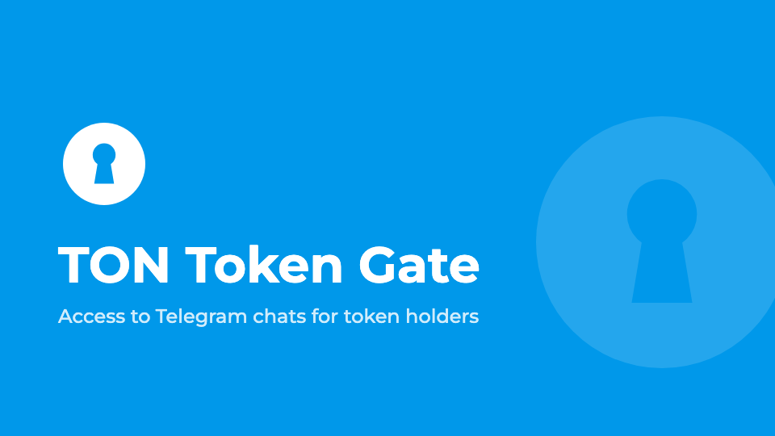

# 🤖 TON Token Gate

[](https://github.com/nessshon/tontokengate-bot/blob/main/LICENSE)
[](https://ton.org)
[](https://core.telegram.org/bots)
[](https://www.python.org/downloads/release/python-3120/)
[](https://redis.io/)
[](https://www.docker.com/)



**TON Token Gate** is a Telegram bot for private chats and channels: it lets in only the holders of your NFT
collections and jettons and removes members who no longer hold them.

**Features**:
* **Token gating.** NFT collections and jettons, each with its own minimum.
* **Wallet check.** Users connect a wallet with TON Connect and prove they own it.
* **Regular checks.** Members who sold their tokens are removed.
* **Languages.** A file per language in [locales](locales); users pick theirs.

## Usage

### Preparation

1. Create a bot via [@BotFather](https://t.me/BotFather) and save its token (`BOT_TOKEN`).
2. Get your user ID from [What's my Telegram ID?](https://t.me/my_id_bot) (`BOT_ADMIN_ID`).
3. Recommended: get a Toncenter API key in [@toncenter](https://t.me/toncenter) (`TONCENTER_KEY`). Without it the bot
   makes 1 request per 1.2 seconds, and checks of large chats are slow.
4. Optionally, edit the bot texts in [locales](locales) and uncomment the `locales` lines in `compose.yaml`: the bot
   then reads the texts from the folder, not from the image.
5. Optionally, add a language the same way: copy `en.toml` to `de.toml` (the language code) and translate it.

### Installation

1. Clone the repository:

   ```bash
   git clone https://github.com/nessshon/tontokengate-bot.git
   ```

2. Change into the bot directory:

   ```bash
   cd tontokengate-bot
   ```

3. Copy the environment variables file:

   ```bash
   cp .env.example .env
   ```

4. Configure the [environment variables](#environment-variables-reference) file:

   ```bash
   nano .env
   ```

5. Start the bot, the ready image is downloaded from GitHub:

   ```bash
   docker compose up -d
   ```

   Check that it started: `docker compose logs -f bot`.

6. In Telegram, send `/start` to the bot and connect a wallet, then add a token in `/admin`.
7. Add the bot to your group or channel as an admin with the rights to invite and ban users, and confirm the chat in
   the bot.
8. Share only the invite link from the bot and revoke the old ones: the bot checks only those who joined by its link.

### Updating

```bash
docker compose pull
docker compose up -d
```

## Environment Variables Reference

| Variable             | Description                                                                                                                       | Example                             |
|----------------------|-----------------------------------------------------------------------------------------------------------------------------------|-------------------------------------|
| `BOT_TOKEN`          | Bot token from [@BotFather](https://t.me/BotFather)                                                                               | `123456:qweRTY`                     |
| `BOT_ADMIN_ID`       | User ID of the main admin, who also gets error reports                                                                            | `123456789`                         |
| `BOT_GROUP_LANGUAGE` | Optional. Language of the bot messages in chats, `ru` by default                                                                  | `en`                                |
| `DEX_NAME`           | Optional. DEX for buying jettons, `swapcoffee` by default                                                                         | `dedust`, `stonfi` or `swapcoffee`  |
| `IS_TESTNET`         | `true` for the TON testnet                                                                                                        | `false`                             |
| `MANIFEST_URL`       | TON Connect manifest; the default one is in `.env.example`                                                                        | `https://example.com/manifest.json` |
| `WALLETS`            | Optional. Wallets to offer, `app_name` list from [wallets-v2.json](https://config.ton.org/wallets-v2.json), all by default        | `tonkeeper,mytonwallet`             |
| `TONCENTER_KEY`      | Optional. Toncenter API key                                                                                                       | `AE33E...3FYQ`                      |
| `TONCENTER_RPS`      | Optional. Requests per second of your Toncenter plan                                                                              | `10`                                |
| `CHECK_INTERVAL`     | Optional. Minutes between member checks, `5` by default                                                                           | `5`                                 |
| `REDIS_HOST`         | Redis host                                                                                                                        | `redis`                             |
| `REDIS_PORT`         | Redis port                                                                                                                        | `6379`                              |
| `REDIS_DB`           | Redis database number                                                                                                             | `0`                                 |
| `REDIS_USERNAME`     | Optional. Redis ACL username                                                                                                      | `default`                           |
| `REDIS_PASSWORD`     | Optional. Redis password                                                                                                          | `p@ss:w/rd`                         |


## Contribution

We welcome your contributions! If you have ideas for improvement or have identified a bug, please create an issue or submit a pull request.

## License

This repository is distributed under the [MIT License](LICENSE).
